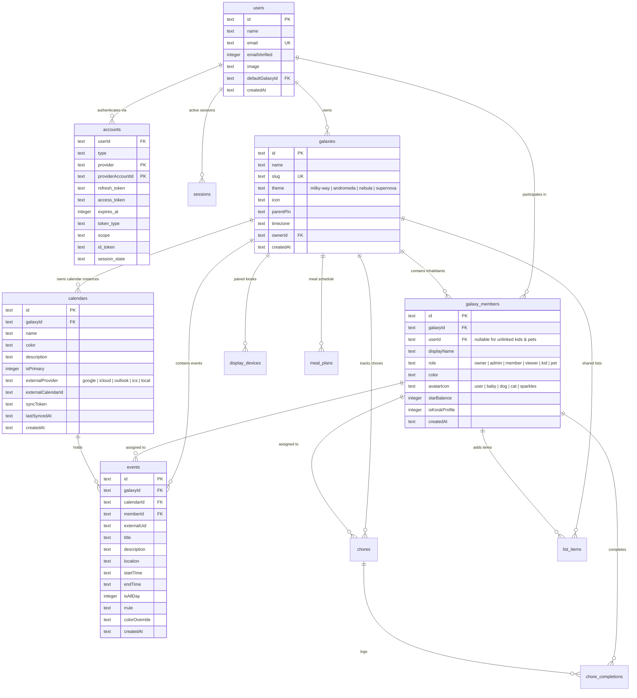
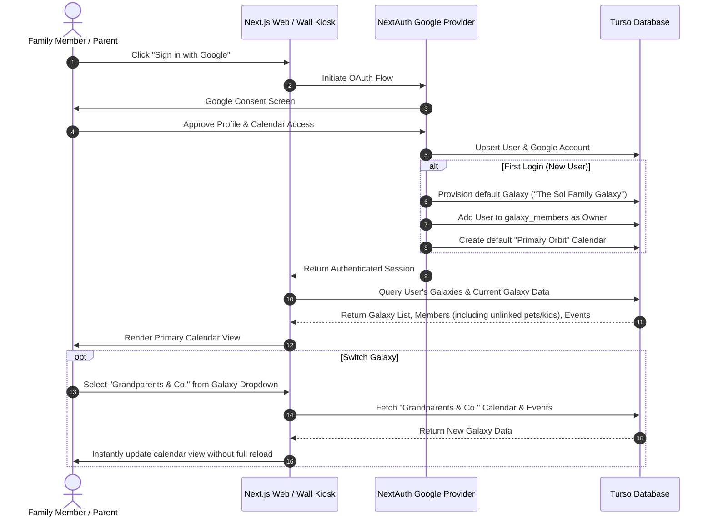

# ADR 0007: Multi-Galaxy Domain Model, Google OAuth & Account Architecture

## Status
Accepted

## Context
Families and modern multi-household units often have complex scheduling relationships:
1. A parent may be part of an immediate household, an extended family group with grandparents, and a kids-only activity circle.
2. A single user needs to seamlessly switch between different "Galaxies" (collaborative groups/households) without signing out.
3. Every Galaxy owns dedicated calendar instances that populate events into the shared interface.
4. Households include members who do **not** have Google accounts:
   - Young children who interact via kiosk / chore boards.
   - Household pets (e.g. "Java" the dog) who have schedules (vet appointments, grooming, medication).
   - Distant relatives or babysitters.
5. In staging and production, we use **Turso (libSQL)** with Next.js 15. We require a robust, repeatable migration pipeline that prevents table collision bugs.

## Decision

### 1. The "Galaxy" Concept (Celestial Group Multi-Tenancy)
Rebrand the root tenancy model from static `households` to **`galaxies`**:
- A **Galaxy** is an autonomous group space with its own settings, theme (e.g., Milky Way, Andromeda, Orion, Supernova), timezone, and wall kiosk Parent PIN.
- A **User** (authenticated via Google OAuth) can own and belong to multiple Galaxies.
- A **Galaxy Member** (inhabitant) represents a profile within a specific Galaxy. A member can either link to an authenticated `userId` OR be a local/unlinked profile (kids, pets like Java the dog).
- A **Calendar** is an instance belonging to a Galaxy. Events are stored in calendars within galaxies.

### 2. Google OAuth Integration (NextAuth / Auth.js)
- Standard OAuth 2.0 flow via Google Provider.
- Upon first sign-in:
  - Upsert `users` and `accounts` records.
  - Automatically provision the user's default Galaxy (e.g. *"<Name>'s Galaxy"*).
  - Create the user's primary `galaxy_members` profile with role `owner`.
  - Create the Galaxy's default `Primary Orbit` calendar.
- Sessions allow secure API access, while unauthenticated wall kiosks can be paired via device tokens.

### 3. Idempotent Migration Runner
- Provide a dedicated programmatic migration runner `src/db/migrate.ts` (`npm run db:migrate`).
- Ensures clean migration execution and journal recording in `__drizzle_migrations` for both Turso and SQLite.

## Architecture Diagrams

### Entity-Relationship Diagram

### Authentication & Multi-Galaxy Switching Flow

## Consequences
- **Positive**: Complete support for multi-household switching, unlinked kid/pet profiles (Java the dog), scalable multi-tenant architecture, and robust Google OAuth.
- **Negative**: Adds join relationships (`galaxies` -> `galaxy_members` -> `users`); requires proper indexing and foreign key constraints on `galaxyId`.
